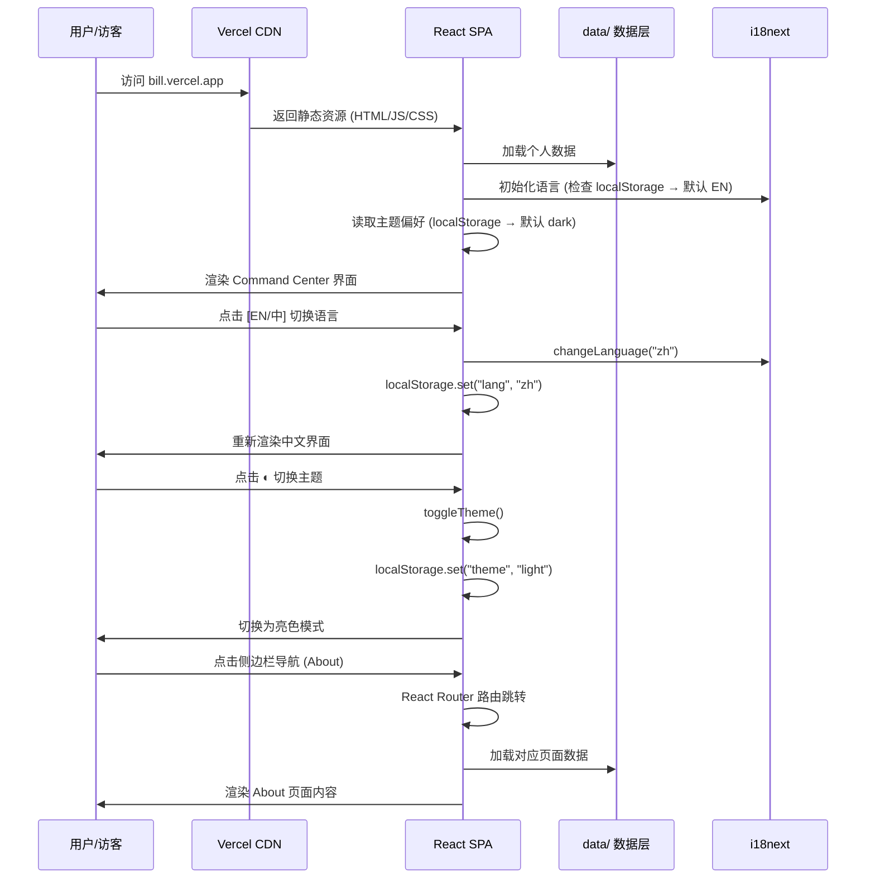
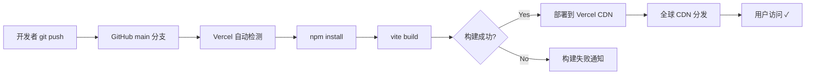
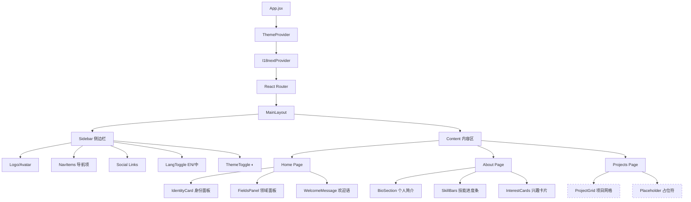

# PRD: Bill's Personal Website — Command Center

> 文档版本: v1.0
> 创建日期: 2025-02-20
> 状态: ✅ 已确认锁定

---

## 一、产品路线图 (Product Roadmap)

### 核心目标 (Mission)

> 为 Bill 打造一个具有**太空指挥中心**视觉风格的个人品牌网站，展示其 AI Native + Web3 Explorer 的独特身份，服务于职业求职与个人品牌建设。

### 用户画像 (Persona)

| 维度 | 描述 |
|------|------|
| **主要受众** | 招聘者 / HR / 技术面试官 |
| **核心痛点** | 30秒内快速了解候选人的技术定位、能力和个人特质 |
| **次要受众** | 技术同行 / Web3 社区 |
| **次要痛点** | 寻找有共同兴趣和技术深度的人 |

### 网站主人画像

| 维度 | 描述 |
|------|------|
| **名字** | Bill |
| **身份** | AI Native · Web3 Explorer |
| **兴趣** | History · Economy · Technology |
| **语言** | 中英双语 |
| **社交** | GitHub |

---

### V1: 最小可行产品 (MVP)

1. **Home 首页（指挥中心主面板）**
   - Identity Card：姓名、角色、领域、在线状态
   - 欢迎语/系统启动提示风格
   - CTA 按钮（GitHub / 查看更多）

2. **About 关于我**
   - 个人简介（AI、Web3、历史、经济多维度）
   - 技能进度条展示（Skill Bars）
   - 兴趣领域面板（Fields Panel）

3. **Projects 项目（占位符版）**
   - 终端风格 "UNDER_CONSTRUCTION" 提示
   - GitHub Profile 链接作为过渡
   - 预留项目卡片组件结构

4. **Contact 联系方式**
   - 集成在侧边栏底部 + Footer
   - GitHub 链接

5. **全局功能**
   - 🌓 暗/亮模式切换（暗色为默认）
   - 🌐 中英双语切换（react-i18next）
   - 📱 响应式设计（移动端侧边栏收起为顶部汉堡菜单）
   - 🎨 科技感视觉风格（Command Center 仪表盘）

6. **部署**
   - Vercel 自动部署（push to main 触发）

### V2 及以后版本 (Future Releases)

| 版本 | 功能 |
|------|------|
| **V2.0** | Experience 工作/实习经历时间线页面 |
| **V2.0** | Projects 完整项目展示（卡片 + 详情页） |
| **V2.1** | Blog/Articles 博客系统（接入 Notion/MDX） |
| **V2.2** | 更多社交链接（LinkedIn、Twitter/X、Email） |
| **V3.0** | 隐藏管理面板（在线编辑内容） |
| **V3.0** | SEO 优化 & Analytics 集成 |
| **V3.1** | 动画增强（粒子背景、数据流动画） |
| **V3.1** | 音效系统（可选开关） |

---

## 二、关键业务逻辑 (Business Rules)

1. **数据驱动架构**：所有个人内容集中存储在 `src/data/` 目录的 JS/TS 文件中，修改数据即可更新网站，无需改动组件代码。

2. **双语机制**：通过 `react-i18next` 实现中英切换。
   - 默认语言：英文
   - 切换方式：顶栏 `[EN/中]` 按钮
   - 语言偏好持久化至 `localStorage`

3. **主题系统**：
   - 暗色模式为默认（符合 Command Center 风格）
   - 用户偏好持久化至 `localStorage`
   - CSS 变量控制主题色，一键切换

4. **Projects 占位策略**：
   - MVP 阶段显示 "UNDER_CONSTRUCTION" 终端风格提示
   - 数据文件中 `projects: []` 为空时自动展示占位符
   - 数组有数据时自动切换为项目卡片网格展示

5. **响应式策略**：
   - Desktop (≥1024px)：左侧固定侧边栏 + 右侧内容面板
   - Tablet (768-1023px)：侧边栏收窄为图标模式
   - Mobile (<768px)：侧边栏隐藏，顶部汉堡菜单展开

6. **部署流水线**：
   - Git push to `main` → Vercel 自动构建 → 发布上线
   - 无需手动部署

---

## 三、数据契约 (Data Contract)

### MVP 数据结构

```javascript
// ========================================
// src/data/personalInfo.js
// ========================================
export const personalInfo = {
  name: "Bill",
  tagline: {
    en: "AI Native | Web3 Explorer",
    zh: "AI 原住民 | Web3 探索者"
  },
  bio: {
    en: "I live at the intersection of artificial intelligence and decentralized systems. When I'm not training models or exploring on-chain data, you'll find me reading about historical patterns in economics.",
    zh: "我生活在人工智能与去中心化系统的交汇点。当我不在训练模型或探索链上数据时，你会发现我在阅读经济学中的历史规律。"
  },
  status: "Open to opportunities",
  github: "https://github.com/billdeng"
}

// ========================================
// src/data/skillsData.js
// ========================================
export const skills = [
  {
    category: { en: "AI / ML", zh: "人工智能 / 机器学习" },
    level: 85, // 进度条百分比
    items: ["Python", "PyTorch", "LangChain", "HuggingFace", "OpenAI API"]
  },
  {
    category: { en: "Web3 / Blockchain", zh: "Web3 / 区块链" },
    level: 70,
    items: ["Solidity", "Ethers.js", "Wagmi", "Hardhat", "The Graph"]
  },
  {
    category: { en: "Frontend", zh: "前端开发" },
    level: 65,
    items: ["React", "TypeScript", "Tailwind CSS", "Next.js", "Vite"]
  },
  {
    category: { en: "DevOps / Tools", zh: "运维 / 工具" },
    level: 50,
    items: ["Docker", "Git", "Linux", "Vercel", "GitHub Actions"]
  }
]

// ========================================
// src/data/interestsData.js
// ========================================
export const interests = [
  {
    label: { en: "History", zh: "历史" },
    icon: "📜",
    description: {
      en: "Patterns of civilization and their echoes in modern times",
      zh: "文明的规律及其在现代的回响"
    }
  },
  {
    label: { en: "Economy", zh: "经济" },
    icon: "📊",
    description: {
      en: "Macro trends, monetary policy, and market dynamics",
      zh: "宏观趋势、货币政策与市场动态"
    }
  },
  {
    label: { en: "Technology", zh: "科技" },
    icon: "🔬",
    description: {
      en: "Emerging tech at the frontier of AI and decentralization",
      zh: "AI 与去中心化前沿的新兴技术"
    }
  }
]

// ========================================
// src/data/projectsData.js
// ========================================
export const projects = []
// V2 时填充，结构预留：
// {
//   id: "project-1",
//   title: { en: "...", zh: "..." },
//   description: { en: "...", zh: "..." },
//   tags: ["React", "AI"],
//   github: "https://github.com/...",
//   demo: "https://...",
//   image: "..."
// }

// ========================================
// src/data/navData.js
// ========================================
export const navItems = [
  { path: "/", label: { en: "Home", zh: "首页" }, icon: "Home" },
  { path: "/about", label: { en: "About", zh: "关于" }, icon: "User" },
  { path: "/projects", label: { en: "Projects", zh: "项目" }, icon: "Code" }
]

// ========================================
// src/data/siteConfig.js
// ========================================
export const siteConfig = {
  title: "Bill — Command Center",
  description: {
    en: "AI Native | Web3 Explorer | History & Economy Enthusiast",
    zh: "AI 原住民 | Web3 探索者 | 历史与经济爱好者"
  },
  defaultLang: "en",
  defaultTheme: "dark"
}
```

---

## 四、MVP 选定原型：方案 B「Command Center」

### 设计说明

**核心理念**：太空指挥中心 / 仪表盘风格。用户（访客）就像进入了一个数据中心，所有关于 Bill 的信息以"面板 (Panel)"的形式有序排列，既专业又充满科技感。

### 视觉规范

```
配色方案（暗色模式为主）：
─────────────────────────────
  背景主色:    #0A0E17 (深空黑)
  面板背景:    #111827 (深灰蓝)
  面板边框:    #1E293B (暗边框)
  主强调色:    #00F0FF (赛博青/Cyan)
  次强调色:    #8B5CF6 (电光紫)
  成功/在线:   #10B981 (矩阵绿)
  文字主色:    #E2E8F0 (亮灰白)
  文字次色:    #94A3B8 (暗灰)

亮色模式：
─────────────────────────────
  背景主色:    #F8FAFC (极浅灰)
  面板背景:    #FFFFFF (白)
  面板边框:    #E2E8F0 (浅灰)
  主强调色:    #0891B2 (深青)
  次强调色:    #7C3AED (深紫)
  文字主色:    #1E293B (深色)

字体：
─────────────────────────────
  标题/系统文字:  JetBrains Mono / Fira Code (等宽字体)
  正文:           Inter / system-ui (无衬线)

间距与圆角：
─────────────────────────────
  面板圆角:    8px
  面板间距:    16px
  内边距:      20px - 24px
```

### 选定原型图

```
┌──────────────────────────────────────────────────────────────────┐
│                        DESKTOP (≥1024px)                        │
├────────────┬─────────────────────────────────────────────────────┤
│            │  [EN/中]              Bill — Command Center   [◐]  │
│  ┌──────┐  ├─────────────────────────────────────────────────────┤
│  │ BILL │  │                                                    │
│  │  ◉   │  │  > SYSTEM_ONLINE ──────────────────────────        │
│  └──────┘  │                                                    │
│            │  ┌──────────────────────────────────────────────┐  │
│ ────────── │  │  IDENTITY                    ┌────────────┐  │  │
│            │  │  ═══════                     │ STAT:FIELDS│  │  │
│  ● Home    │  │  Name:   Bill                │            │  │  │
│            │  │  Role:   AI Native           │ ◉ AI / ML  │  │  │
│  ○ About   │  │  Domain: Web3 · AI ·         │ ◉ Web3     │  │  │
│            │  │          History · Economy    │ ◉ History  │  │  │
│  ○ Projects│  │  Status: ● Open to           │ ◉ Economy  │  │  │
│            │  │            opportunities     │            │  │  │
│ ────────── │  │                              └────────────┘  │  │
│            │  └──────────────────────────────────────────────┘  │
│  LINKS     │                                                    │
│  ┌──────┐  │  ┌────────────────────┐  ┌────────────────────┐   │
│  │GitHub│  │  │ SKILL: AI/ML       │  │ SKILL: Web3        │   │
│  └──────┘  │  │ ████████████░░ 85% │  │ ██████████░░░░ 70% │   │
│            │  │ Python · PyTorch   │  │ Solidity · Ethers  │   │
│            │  │ LangChain · HF     │  │ Wagmi · Hardhat    │   │
│            │  └────────────────────┘  └────────────────────┘   │
│            │                                                    │
│            │  ┌────────────────────┐  ┌────────────────────┐   │
│            │  │ SKILL: Frontend    │  │ SKILL: DevOps      │   │
│            │  │ █████████░░░░░ 65% │  │ ███████░░░░░░░ 50% │   │
│            │  │ React · TypeScript │  │ Docker · Git       │   │
│            │  │ Tailwind · Next.js │  │ Linux · Vercel     │   │
│            │  └────────────────────┘  └────────────────────┘   │
│            │                                                    │
│            │  © 2025 Bill · All Systems Operational             │
├────────────┴─────────────────────────────────────────────────────┤
│                        MOBILE (<768px)                          │
├─────────────────────────────────────────────────────────────────┤
│  ☰  Bill — Command Center       [EN/中] [◐]                    │
├─────────────────────────────────────────────────────────────────┤
│                                                                 │
│  > SYSTEM_ONLINE                                                │
│                                                                 │
│  ┌───────────────────────────────────────────────┐              │
│  │  IDENTITY           ● Online                  │              │
│  │  Name: Bill                                   │              │
│  │  Role: AI Native | Web3 Explorer              │              │
│  │  [ GitHub → ]                                 │              │
│  └───────────────────────────────────────────────┘              │
│                                                                 │
│  ┌───────────────────────────────────────────────┐              │
│  │  FIELDS: AI/ML · Web3 · History · Economy     │              │
│  └───────────────────────────────────────────────┘              │
│                                                                 │
│  ┌───────────────────────────────────────────────┐              │
│  │  AI/ML        ████████████░░░ 85%             │              │
│  │  Web3         ██████████░░░░░ 70%             │              │
│  │  Frontend     █████████░░░░░░ 65%             │              │
│  │  DevOps       ███████░░░░░░░░ 50%             │              │
│  └───────────────────────────────────────────────┘              │
│                                                                 │
│  © 2025 Bill                                                    │
└─────────────────────────────────────────────────────────────────┘
```

---

## 五、架构设计蓝图

### 5.1 核心流程图

#### 用户访问流程



#### 构建部署流程



#### 组件架构



### 5.2 文件结构与组件交互说明

#### 需要删除的原有文件/模块

```
❌ 删除 - 不在 MVP 范围内:
├── src/pages/Articles/          (文章模块 → V2.1)
├── src/pages/Compete/           (竞赛模块 → V2+)
├── src/pages/Education/         (教育模块 → V2)
├── src/pages/Experience/        (经历模块 → V2.0)
├── src/pages/Miscellaneous/     (杂项模块全部 → V2+)
│   ├── MasterTechChild/
│   ├── ConnectPeople.jsx
│   ├── FourTierMastery.jsx
│   ├── GitHubDevHubRepos.jsx
│   ├── Mentors.jsx
│   ├── MyBucketList.jsx
│   ├── MyJourney.jsx
│   ├── mythought.jsx
│   ├── ScreenTimeChronicleFullPage.jsx
│   └── StartPy.jsx
├── src/pages/Dashboard/         (管理面板 → V3.0)
├── src/hooks/keyListener.jsx    (快捷键 → V3.0)
├── src/utils/soundsPlaying.js   (音效 → V3.1)
├── src/assets/sounds/           (音效文件 → V3.1)
├── src/components/ArticleSingleShow.jsx
├── src/components/MovieShowCard.jsx
├── src/components/ExperienceCard.jsx
├── /firebase.json               (改用 Vercel)
├── /firestore.rules
├── /firestore.indexes.json
├── /dataconnect/
├── /.github/workflows/firebase-deploy.yml
```

#### 需要修改的文件

```
✏️ 重构/修改:
├── src/App.jsx                  (简化路由，移除多余页面)
├── src/main.jsx                 (添加 i18n 初始化)
├── src/routers/AppRouter.jsx    (仅保留 3 条路由)
├── src/layouts/MainLayout.jsx   (改为侧边栏 + 内容区布局)
├── src/components/Navbar/       (重构为 Sidebar 组件)
├── src/contexts/ThemeContext.jsx (优化主题逻辑)
├── src/data/ (全部重写)         (替换为 Bill 的个人数据)
├── tailwind.config.js           (更新配色方案)
├── index.html                   (更新 title、meta)
├── vite.config.js               (移除不需要的 alias)
├── package.json                 (移除 Firebase 依赖，加 i18n)
```

#### 需要新增的文件

```
✅ 新增:
├── src/i18n/
│   ├── index.js                 (i18n 配置)
│   ├── locales/
│   │   ├── en.json              (英文翻译)
│   │   └── zh.json              (中文翻译)
├── src/components/Sidebar/
│   ├── Sidebar.jsx              (桌面端侧边栏)
│   ├── MobileSidebar.jsx        (移动端抽屉菜单)
│   └── NavItem.jsx              (导航项组件)
├── src/components/Panels/
│   ├── IdentityCard.jsx         (身份信息面板)
│   ├── FieldsPanel.jsx          (领域/兴趣面板)
│   ├── SkillBar.jsx             (技能进度条)
│   ├── InterestCard.jsx         (兴趣卡片)
│   └── ProjectPlaceholder.jsx   (项目占位符)
├── src/components/LangToggle.jsx(语言切换按钮)
├── src/components/ThemeToggle.jsx(主题切换按钮)
├── src/components/SystemBanner.jsx(顶部系统状态栏)
├── src/data/personalInfo.js     (个人信息数据)
├── src/data/skillsData.js       (技能数据)
├── src/data/interestsData.js    (兴趣数据)
├── src/data/navData.js          (导航数据)
├── src/data/siteConfig.js       (站点配置)
├── vercel.json                  (Vercel SPA 路由配置)
```

### 5.3 技术选型与风险

#### 技术选型

| 技术 | 选型 | 理由 |
|------|------|------|
| **框架** | React 18 (保留) | 原项目已用 React，无需迁移成本 |
| **构建** | Vite 6 (保留) | 极快的 HMR，开发体验优秀 |
| **样式** | Tailwind CSS + Shadcn UI (保留) | 原项目已集成，组件库完善 |
| **国际化** | react-i18next (新增) | React 生态最成熟的 i18n 方案，支持懒加载 |
| **路由** | React Router v7 (保留) | 原项目已用，无需更换 |
| **动画** | Motion (Framer Motion) (保留) | 原项目已有依赖，适合面板进入/退出动画 |
| **字体** | JetBrains Mono + Inter (替换) | 等宽字体强化科技感，Inter 提升正文可读性 |
| **部署** | Vercel (替换 Firebase) | 零配置部署，全球 CDN，免费额度充足 |
| **图标** | Lucide React (保留/新增) | 轻量、风格统一、与 Shadcn 完美配合 |

#### 潜在风险与应对

| 风险 | 概率 | 影响 | 应对策略 |
|------|------|------|----------|
| **双语内容维护成本高** | 中 | 中 | 集中在 data/ 文件管理，使用统一的 `{en, zh}` 结构 |
| **删除大量模块后残余引用** | 高 | 低 | 分步删除，每删一批跑一次 build 验证 |
| **侧边栏布局在移动端适配** | 中 | 中 | 移动端直接切换为顶部导航 + 抽屉菜单，不强行保留侧边栏 |
| **原项目 Firebase 深度耦合** | 低 | 低 | 原项目 Firebase 仅用于 Hosting，代码中无 Firestore 读写，迁移成本极低 |
| **等宽字体中文显示效果** | 中 | 低 | 标题/系统文字用等宽，中文正文用 Inter/system-ui，混合使用 |
| **Vercel 免费额度限制** | 低 | 低 | 个人网站流量极低，免费额度绰绰有余 |

---

## 六、开发计划摘要

### MVP 开发步骤（建议顺序）

| 步骤 | 任务 | 预估改动 |
|------|------|----------|
| 1 | 清理：删除不需要的页面和组件 | 删除 ~30 文件 |
| 2 | 数据层：创建新的数据文件 | 新增 5 文件 |
| 3 | 国际化：集成 react-i18next | 新增 3 文件 + 修改 2 文件 |
| 4 | 布局：实现 Sidebar + Content 布局 | 新增 4 文件 + 重构 2 文件 |
| 5 | 首页：实现 Identity Card + Fields Panel | 新增 3 组件 |
| 6 | 关于页：实现 Bio + SkillBars + Interests | 新增 3 组件 |
| 7 | 项目页：实现占位符 | 新增 1 组件 |
| 8 | 样式：配色方案 + 科技感视觉 | 修改 tailwind config + 全局 CSS |
| 9 | 响应式：移动端适配 | 修改布局组件 |
| 10 | 部署：配置 Vercel | 新增 vercel.json + 连接 GitHub |

---

> **文档状态**：已锁定 ✅
> **下一步**：等待指令开始 MVP 开发
