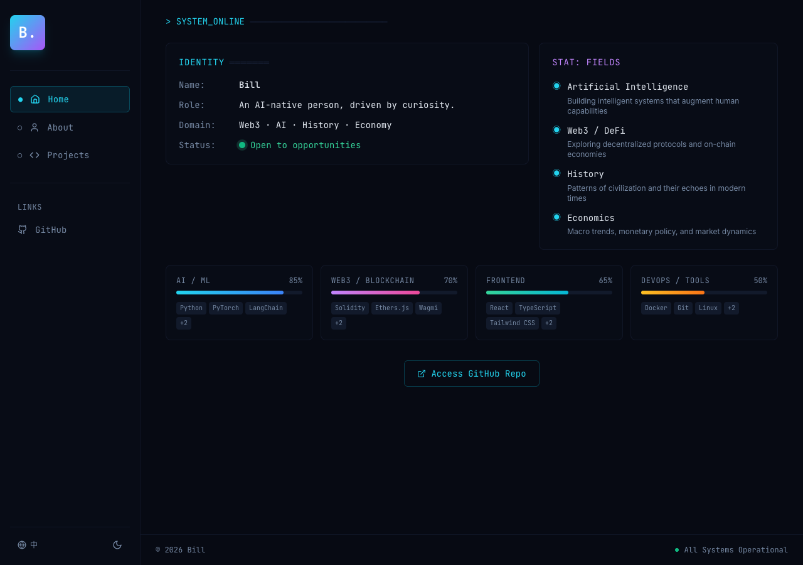
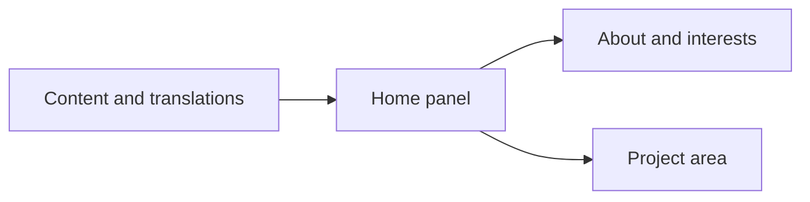

# Bill's Command Center

**English** · [简体中文](README.zh-CN.md)

A personal website with a small mission-control daydream.



A React/Vite site that presents a home panel, an about page, and a project area in a command-center visual language. The implementation includes English/Chinese navigation, theme controls, responsive navigation, and data-driven personal content.

## Run locally

```bash
git clone https://github.com/Bill306/bill-command-center.git
cd bill-command-center/frontend
npm ci
npm run dev
```

Use the local address printed by Vite. Build and preview with `npm run build` and `npm run preview` from `frontend/`.

## Find your way around

Personal content lives in `frontend/src/data/`; translations and language setup live under `frontend/src/i18n/`; pages live in `frontend/src/pages/`. [Prd.md](Prd.md) preserves the original design brief, including planned items. Planned content in that brief should be checked against the implemented pages.

The website introduction is **“An AI-native person, driven by curiosity.”** Personal text and GitHub links are maintained in the content files. Hosted deployment status requires a separate check.


