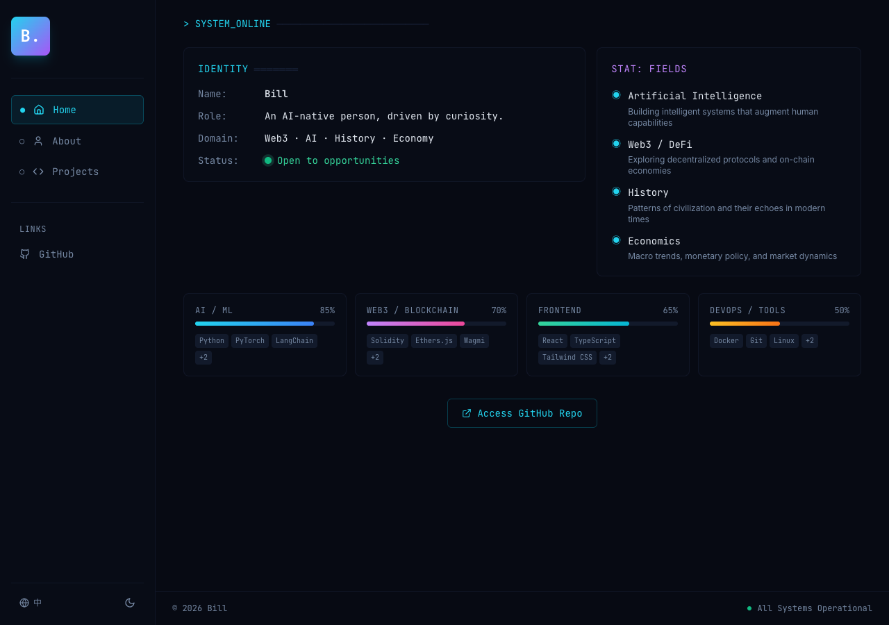

# Bill's Command Center

[English](README.md) · **简体中文**

把个人网站想象成一个小小的太空指挥室。



一个使用 React 和 Vite 的个人网站，包含首页面板、个人介绍和项目区域，提供中英文切换、主题控制、响应式导航，以及通过数据文件管理的个人内容。

## 本地运行

```bash
git clone https://github.com/Bill306/bill-command-center.git
cd bill-command-center/frontend
npm ci
npm run dev
```

使用 Vite 输出的本机地址。在 `frontend/` 中运行 `npm run build` 构建，运行 `npm run preview` 预览构建结果。

## 文件与状态

个人内容位于 `frontend/src/data/`，语言设置和翻译位于 `frontend/src/i18n/`，页面位于 `frontend/src/pages/`。[Prd.md](Prd.md) 保留原始设计说明，其中包含计划功能；功能状态需要结合当前页面查看。

网站使用的介绍是 **“An AI-native person, driven by curiosity.”** 个人介绍和 GitHub 链接通过内容文件维护。这里提供仓库代码的运行说明，部署状态需要另外核验。


